```mermaid
flowchart LR
  US[user-story/] --> O{{sdlc-orchestrator}}
  O --> R[1 requirements-analyst] --> G1((G1))
  G1 --> A[2 architect] --> G2((G2))
  G2 --> D[3 design-reviewer] --> G3((G3))
  G3 -->|blockers| A
  G3 --> P[4 implementation-planner] --> G4((G4))
  G4 --> I[5 implementer] --> G5((G5))
  G5 --> CR[6 code-reviewer] --> G6((G6))
  G6 -->|findings| I
  G6 --> V[7 verifier] --> G7((G7))
  G7 -->|failures| I
  G7 --> PR[8 pr-creator] --> G8((G8)) --> PRURL[Pull Request]
  DS[[docs-sync after every stage]] -.-> O
```

# TODO App - Create a Task

A single-page TODO app. Type a task title, press **Add Task** (or Enter), and the task appears in the list and is saved in your browser's local storage. Tasks are still there after a refresh.

Scope of this version: creating tasks only. Editing, deleting, completing tasks, due dates, accounts, and any server are out of scope (see [requirements](docs/requirements.md)).

## Run it

Open `index.html` in a current Chrome, Edge, Firefox, or Safari. You can double-click the file; no server and no build step are needed. There are no runtime dependencies and no configuration (no environment variables, so no `.env.example`).

## What it does

- Rejects empty, whitespace-only, and invisible-character-only titles, and titles over 100 characters (counted in Unicode code points), with a message under the input.
- Trims the title, allows duplicate titles, and lists tasks in creation order, newest at the bottom.
- Saves to `localStorage` under the key `todo-app.tasks.v1`.
- Keeps working if local storage is blocked or its data is unreadable: a warning is shown and tasks stay in memory. Unreadable data is copied to `todo-app.tasks.v1.unreadable` before it is replaced.
- Works in several tabs: a new task is added to the saved list, not over it, and other tabs update.
- Keyboard and screen-reader friendly: labelled input, error announced as an alert, "Task added: ..." announced after each add.

Tasks belong to the browser and to the file's location. Opening the page from a different folder, a different browser, or a private window shows a different (possibly empty) list. Moving the folder can make saved tasks seem lost.

## Develop and test

Requires Node `^20.19.0 || ^22.12.0 || >=24.0.0`.

```
npm install
npm test
```

`npm test` runs the Node test runner over unit tests (validator, store, service) and jsdom page tests that load the real `index.html` and scripts. jsdom is a development dependency only. Real-browser checks (layout, Enter key, screen readers, `file://` behaviour) are listed in [docs/manual-test-checklist.md](docs/manual-test-checklist.md).

## Project structure

```
index.html                 page and bootstrap
src/
  styles.css
  task-validator.js        title rules (pure)
  task-store.js            localStorage read / write / backup (no DOM)
  task-service.js          task list, ids, pending unsaved tasks (no DOM)
  task-view.js             DOM rendering and messages (textContent only)
  app.js                   wiring: Todo.startApp
tests/                     helpers, unit, integration, fixtures
docs/                      requirements, architecture, design review, plan, reviews, checklist
```

Design documents: [requirements](docs/requirements.md), [architecture](docs/architecture.md), [design review](docs/design-review.md), [implementation plan](docs/impl-plan.md), [traceability](docs/traceability.md).

---

## Agentic SDLC Pipeline (GitHub Copilot)

Upload a user story, run one orchestrator, approve at each gate, get a Pull Request. Every phase is a Copilot custom agent; documentation is kept in sync after every stage.

### Quick start

1. Open this folder in VS Code with GitHub Copilot (agent mode) or use Copilot CLI.
2. Put the user story in `user-story/` (or have a JIRA/Confluence key ready).
3. Run the prompt **`/run-sdlc`** (it launches the `sdlc-orchestrator` agent).
4. Answer clarifying questions, review each artifact, reply **Approve**, **Request changes**, or **Abort** at each gate.
5. To continue an interrupted run: **`/resume-sdlc`**. To sync docs manually: **`/sync-docs`**.

### How it flows



Every `Gn` is a human approval. Each approved stage is committed on `feature/<slug>`.

### What is in `.github/`

| Path | Contents |
|------|----------|
| `copilot-instructions.md` | Repo-wide rules, stage/artifact table |
| `agents/` | `sdlc-orchestrator`, `requirements-analyst`, `architect`, `design-reviewer`, `implementation-planner`, `implementer`, `code-reviewer`, `verifier`, `docs-sync`, `pr-creator` |
| `instructions/` | `security`, `documentation`, `code`, `testing`, `agent-collaboration` (scoped with `applyTo`) |
| `prompts/` | `run-sdlc`, `resume-sdlc`, `sync-docs` |
| `skills/` | `user-story-intake`, `docs-sync-check`, `pr-authoring` |
| `hooks/` | Guard rails (block force-push, secrets, `.env` writes), docs-drift marker, session logging |

### Artifacts produced

`docs/requirements.md` → `architecture.md` → `design-review.md` → `impl-plan.md` → code and tests → `code-review.md` → `verification-report.md` → `pr-description.md`, plus `docs/traceability.md`, `README.md`, `CHANGELOG.md`, and `.sdlc/state.md` (resume state).

### Requirements

- Git repository (the orchestrator asks before running `git init`).
- `gh` CLI authenticated, for automatic PR creation. Without it, you get the finished PR description and manual commands.
- Optional: `pandoc` or `python-docx` for `.docx` stories; an Atlassian MCP server for JIRA/Confluence.
