# Agentic SDLC Pipeline (GitHub Copilot)

Upload a user story, run one orchestrator, approve at each gate, get a Pull Request. Every phase is a Copilot custom agent; documentation is kept in sync after every stage.

## Quick start

1. Open this folder in VS Code with GitHub Copilot (agent mode) or use Copilot CLI.
2. Put the user story in `user-story/` (or have a JIRA/Confluence key ready).
3. Run the prompt **`/run-sdlc`** (it launches the `sdlc-orchestrator` agent).
4. Answer clarifying questions, review each artifact, reply **Approve**, **Request changes**, or **Abort** at each gate.
5. To continue an interrupted run: **`/resume-sdlc`**. To sync docs manually: **`/sync-docs`**.

## How it flows

```mermaid
flowchart LR
  US[user-story/] --> O{{sdlc-orchestrator}}
  O --> R[1 requirements-analyst] --> G1((G1))
  G1 --> A[2 architect] --> G2((G2))
  G2 --> D[3 design-reviewer] --> G3((G3))
  G3 -->|blockers| A
  G3 --> P[4 implementation-planner] --> G4((G4))
  G4 --> I[5 implementer] --> G5((G5))
  G5 --> CR[6 code-reviewer] --> G6((G6))
  G6 -->|findings| I
  G6 --> V[7 verifier] --> G7((G7))
  G7 -->|failures| I
  G7 --> PR[8 pr-creator] --> G8((G8)) --> PRURL[Pull Request]
  DS[[docs-sync after every stage]] -.-> O
```

Every `Gn` is a human approval. Each approved stage is committed on `feature/<slug>`.

## What is in `.github/`

| Path | Contents |
|------|----------|
| `copilot-instructions.md` | Repo-wide rules, stage/artifact table |
| `agents/` | `sdlc-orchestrator`, `requirements-analyst`, `architect`, `design-reviewer`, `implementation-planner`, `implementer`, `code-reviewer`, `verifier`, `docs-sync`, `pr-creator` |
| `instructions/` | `security`, `documentation`, `code`, `testing`, `agent-collaboration` (scoped with `applyTo`) |
| `prompts/` | `run-sdlc`, `resume-sdlc`, `sync-docs` |
| `skills/` | `user-story-intake`, `docs-sync-check`, `pr-authoring` |
| `hooks/` | Guard rails (block force-push, secrets, `.env` writes), docs-drift marker, session logging |

## Artifacts produced

`docs/requirements.md` → `architecture.md` → `design-review.md` → `impl-plan.md` → code and tests → `code-review.md` → `verification-report.md` → `pr-description.md`, plus `docs/traceability.md`, `README.md`, `CHANGELOG.md`, and `.sdlc/state.md` (resume state).

## Requirements

- Git repository (the orchestrator asks before running `git init`).
- `gh` CLI authenticated, for automatic PR creation. Without it, you get the finished PR description and manual commands.
- Optional: `pandoc` or `python-docx` for `.docx` stories; an Atlassian MCP server for JIRA/Confluence.
