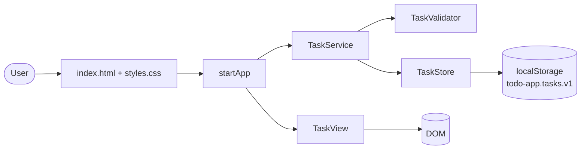
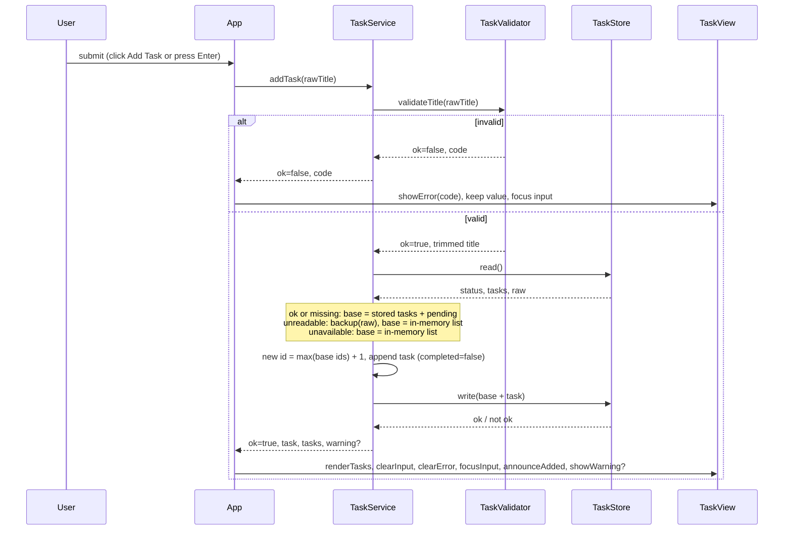

# Architecture — Create a TODO Task

Based on: docs/requirements.md v2, docs/design-review.md rounds 1-2   Version: 3   Status: Approved

## 1. Context & Goals

A static, single-page, single-user TODO page that runs from `index.html` with no server and no build step. The user enters a title, the page validates it, adds it to a list, and saves the list in browser local storage. Main drivers: FR-4/FR-11 (validation), FR-8/FR-9/FR-15 (persistence and its failure modes), NFR-6 (no markup injection), NFR-8 (logic testable without a browser), NFR-10 (no runtime dependencies, no build step).

Decisions taken in design review (human, 2026-11-07): two tabs are in scope (DD-1); no Content-Security-Policy (DD-2); unreadable stored data is backed up before it is replaced (DD-3); the 100-character limit counts code points (DD-4). Confirmed by the human at gate G3: a spoken confirmation after a successful add (DD-5), rejection of titles made only of invisible characters (DD-6), and, if the backup of unreadable data cannot be written, replacing the data anyway with a distinct warning (DD-7).

## 2. Technology Choices

| Concern | Options considered | Decision | Rationale |
|---------|-------------------|----------|-----------|
| Language and UI | Vanilla HTML/CSS/JS; React + Vite; TypeScript + Vite | Vanilla HTML/CSS/JS | Human decision; satisfies NFR-10. The UI is one form and one list. |
| Code loading | A: classic `<script>` files that attach to one global namespace; B: ES modules; C: one large script | A | ES modules are blocked from `file://` in Chrome and Edge (module scripts are fetched with CORS) and behave inconsistently elsewhere, which would break "open index.html" (NFR-10). A keeps separate files (NFR-8). C mixes DOM and logic. |
| Sharing code with Node tests | Dual browser/Node wrapper in each file; test helper that evaluates the same files | Test helper `tests/helpers/load-modules.js` runs each `src/*.js` file with `vm.runInThisContext` in dependency order and returns `globalThis.Todo` | The shipped files contain no `module` or `require` checks, so there is no environment detection to get wrong (DR-6). Node tests run the exact bytes the browser runs. Running in the current context keeps object prototypes shared, so `assert.deepStrictEqual` works. |
| Persistence | `localStorage`; IndexedDB; cookies | `localStorage`, key `todo-app.tasks.v1` holding a JSON array | Required by FR-8 and NFR-4. The prefix `todo-app.` lowers the chance of a clash with other local pages (DR-16). The `v1` suffix allows a later format change. |
| Unit tests | Node built-in `node:test`; Jest; Vitest | `node:test` | No extra dependencies (NFR-8, NFR-10). |
| DOM and integration tests | jsdom (dev dependency); Playwright; hand-written DOM fake | jsdom, pinned in `devDependencies` | Runs the real `index.html` and scripts in Node. Playwright adds browser downloads for a page this small. It is a dev dependency, so NFR-10 holds. |
| Task identity | Random UUID; timestamp; incrementing integer | Incrementing integer, `max(existing ids) + 1`, computed with a loop | Deterministic and testable. `crypto.randomUUID` is unavailable in some insecure contexts. Stored ids must be safe integers of at least 1 and unique, otherwise the data is unreadable (DR-9). |
| Title length unit | UTF-16 length; code points; user-perceived characters (`Intl.Segmenter`) | Code points (`Array.from(title).length`) | Human decision (DD-4). Simple, no feature check. Single-code-point emoji count once; sequences such as family emoji (several code points joined by ZWJ), flags, and skin-tone emoji count as several. A unit test documents this. |
| Length enforcement in the UI | HTML `maxlength`; validation in code | Validation in code only | `maxlength` would stop the 101st character from being typed, so the FR-11 message would never appear. |
| Cross-tab consistency | In-memory list written back whole; read-modify-write on each add; locks | Read-modify-write on each add, plus a `storage` event refresh | Human decision (DD-1). See section 5. Web Locks would remove the remaining race but add complexity for a tiny window. |
| Content-Security-Policy | Meta tag CSP; none | None | Human decision (DD-2). `'self'` matching on `file://` is unverified, no requirement needs a CSP, and a mismatch would blank the page. NFR-6 is met by `textContent`. |
| Node version | any; 20 or later | `engines.node >= 20` | Required for current jsdom and `node:test`. CI is out of scope for this story (`Not Found`); tests run locally with `npm test`. |

## 3. Component Diagram



Dependency rule: `TaskValidator`, `TaskStore`, and `TaskService` never touch the DOM. Only `TaskView` and `App` use `document`. Every component is a factory function on one namespace object: `Todo.createTaskValidator`, `Todo.createTaskStore`, `Todo.createTaskService`, `Todo.createTaskView`, and the entry point `Todo.startApp`. Each receives its dependencies as arguments. Nothing looks up another file's global while its own file is being evaluated, so script order matters only for which names exist when `Todo.startApp` runs.

## 4. Components & Responsibilities

| Component | Responsibility | Inputs | Outputs | Covers |
|-----------|----------------|--------|---------|--------|
| index.html + styles.css | Page structure: a `<form>` containing a labelled input and an **Add Task** submit button; a messages block with an error region (`role="alert"`), a warning region (`role="status"`, visible), and a visually hidden confirmation region (`role="status"`); a `<ul>` for tasks. Responsive layout. Classic scripts at the end of `<body>`, in order: `task-validator.js`, `task-store.js`, `task-service.js`, `task-view.js`, `app.js`, then an inline one-line bootstrap `Todo.startApp({ document: document, getStorage: function () { return window.localStorage; } })`. All regions exist in the initial HTML so announcements work. The input's `aria-describedby` points at the persistent id of the error region (`title-error`), never at a child that is replaced. The confirmation region is hidden with a visually-hidden CSS class (clip), never `display: none` or the `hidden` attribute, which would silence it. No inline event handlers or inline styles. | none | static page | FR-1, FR-2, NFR-1, NFR-3, NFR-7 |
| TaskValidator | `createTaskValidator()` returns `validateTitle(rawTitle)`: trims; rejects a title that is blank, meaning every code point is white space, a control or format character (`\p{Cc}`, `\p{Cf}`, so zero-width space is included), a separator (`\p{Z}`), or one of U+115F, U+1160, U+2800, U+3164 (DD-6); rejects more than 100 code points. Returns `{ ok: true, title }` or `{ ok: false, code: 'EMPTY' }` or `{ ok: false, code: 'TOO_LONG' }`. No message text. | raw string | result object | FR-4, FR-11, FR-13 |
| TaskStore | `createTaskStore(getStorage)`. `read()` returns `{ status, tasks, raw }`. `status` is `'ok'` or `'missing'` (key absent; tasks is empty, no warning) or `'unreadable'` (invalid JSON, not an array, or any record that is not `{ id, title, completed }` with id a unique safe integer of at least 1, title a non-empty string, completed a boolean) or `'unavailable'` (obtaining or using storage throws). `write(tasks)` returns `{ ok }` and never throws. `backup(raw)` copies a raw string to `todo-app.tasks.v1.unreadable` (one slot, newest wins) and returns whether it worked. All storage access and all try/catch lives here. | `getStorage` function | `{ status, tasks, raw }`, `{ ok }` | FR-8, FR-9, FR-15, NFR-4, NFR-5, NFR-6 |
| TaskService | `createTaskService({ validator, store })`. Holds the in-memory list. `init()` reads the store and returns `{ tasks, warning }`. `addTask(rawTitle)` validates, then performs one synchronous read-modify-write (section 5), and returns `{ ok: false, code }` or `{ ok: true, task, tasks, warning }`. A rejection changes nothing. The service keeps a `pending` list of tasks that were added but not yet saved. The displayed list is always stored tasks (when the store is `ok` or `missing`) followed by `pending`; pending tasks get ids above the highest stored id so they cannot collide with a task added in another tab. `pending` is cleared only after a write succeeds. `refresh()` re-reads the store: for `ok` or `missing` it rebuilds the displayed list as stored followed by `pending`; for `unreadable` or `unavailable` it keeps the in-memory list unchanged. `warning` is the warning that applies now: `null` (clear any shown warning) or one code from `UNAVAILABLE`, `UNREADABLE`, `SAVE_FAILED`, `BACKUP_FAILED` (rules in section 5). | validator, store | task list, result objects | FR-3, FR-4, FR-6, FR-8, FR-11, FR-13, FR-14, FR-15, FR-16 |
| TaskView | `createTaskView(document)`. Renders the list with `createElement` and `textContent` only (never `innerHTML` or similar). Shows each title and an "incomplete" status. Owns all message text, keyed by code. `showError(code)` replaces the children of the alert region with a freshly created element (so a repeated identical error is announced again), sets `aria-invalid="true"` and `aria-describedby="title-error"` on the input, and leaves the input value alone. `clearError()` removes the child and both attributes. `showWarning(code)` fills the warning region and keeps it until `showWarning` or `clearWarning()` is called or the page reloads. `announceAdded(title)` replaces the children of the hidden confirmation region with a new element reading "Task added: <title>" (a new node each time, so adding "A" twice is announced twice; DD-5 default). `clearInput()` empties the input. `focusInput()` focuses it. | task list, codes | DOM updates | FR-5, FR-6, FR-7, FR-12, NFR-2, NFR-6, NFR-7 |
| App | `Todo.startApp({ document, getStorage })` is the single entry point and the test seam. It wires the factories, calls `init()`, renders, shows any warning, and registers listeners: form `submit` (always `preventDefault()`), input `input` (calls `clearError()` only, never touches the warning), and `window` `storage` (when `key` equals the storage key or is `null`, calls `refresh()` and re-renders). On a rejected submit it calls `showError`, keeps the typed value, and focuses the input. On success it renders, clears the input, clears any error, focuses the input, announces the addition, and applies the result's warning: a code calls `showWarning`, `null` calls `clearWarning`. | DOM events | calls to service and view | FR-3, FR-5, FR-7, FR-10, FR-12 |

Message text (fixed strings, chosen in implementation, refined within these meanings):
- `EMPTY`: "Task title cannot be empty."
- `TOO_LONG`: "Task title must be 100 characters or fewer."
- `UNAVAILABLE`: "Saving is not available in this browser. Your tasks will be lost when you leave this page."
- `UNREADABLE`: "Your saved tasks could not be read. Adding a task replaces them (a backup copy is kept if there is room)."
- `SAVE_FAILED`: "This task could not be saved and may be lost when you refresh."
- `BACKUP_FAILED`: "Your old saved data could not be copied and has been replaced."

## 5. Data Flow



Page load: `Todo.startApp` calls `service.init()`, which calls `store.read()`. Status `ok` or `missing` renders the stored list. `unreadable` or `unavailable` gives an empty in-memory list and a warning. Nothing is written or backed up at load.

Two tabs (DD-1): `addTask` reads storage again immediately before choosing the id and writing, in one synchronous block, so a task added in another tab since the page loaded is kept and ids stay unique. A `storage` event in the other tab triggers `refresh()` so its list catches up. Browsers do not guarantee a lock between the read and the write across tabs, and a change in one tab can reach another after a cross-process delay. The race is bounded by that delay, is not reachable at human typing speed, and is not eliminated. It is accepted and recorded in section 11.

Failure flows:
- Empty, blank, or over-long title: rejected before any state change; stored data and list are unchanged (FR-4, FR-11, FR-16).
- Storage unavailable: warning `UNAVAILABLE`; the app works in memory (FR-15). `SAVE_FAILED` is never raised in this status, so `UNAVAILABLE` stays visible.
- Stored data unreadable (one bad record makes the whole list unreadable; there is no partial salvage): warning `UNREADABLE` at load. At the next successful add the raw value is copied to the backup key, then replaced (DD-3). If the backup write fails, the add still proceeds and the result warning is `BACKUP_FAILED` (DD-7).
- Save fails while reads work (quota or security error): the task joins `pending` and stays in the displayed list; warning `SAVE_FAILED`. Later adds and `refresh()` keep it on top of the stored list until a write succeeds, so an unsaved task is never dropped from view and its id is unique.

Warning lifecycle: the result of each add carries the warning that applies now. A code replaces any warning on screen; `null` clears it. So `SAVE_FAILED` disappears after a later add succeeds, and `UNREADABLE` disappears once the data has been replaced (with `BACKUP_FAILED` shown instead when the backup failed). Typing in the input never changes a warning (it clears only the error).

## 6. Data Model / File Formats

Task: `{ "id": 1, "title": "Complete Java revision", "completed": false }`

Storage: `localStorage["todo-app.tasks.v1"]` = JSON array of tasks in creation order. A missing key means no tasks and no warning. Backup: `localStorage["todo-app.tasks.v1.unreadable"]` = last unreadable raw string.

Ids come from `max + 1`. If a later story adds delete, id reuse after deleting the highest task must be revisited then.

## 7. Error Handling Strategy

- All `localStorage` access happens in `TaskStore` inside try/catch (including obtaining `window.localStorage`, which can throw `SecurityError`). No exception reaches `TaskService`, `TaskView`, or `App`.
- Validation errors are normal results, not exceptions.
- Message text lives only in `TaskView` and is fixed; it never includes stored data or exception text.
- Errors (cleared by typing) and warnings (persist) are different kinds and never clear each other.
- The submit handler calls `preventDefault()` first, before any code that can throw, so an error inside the handler never turns into a page navigation. A page whose scripts fail to load is dead; the jsdom smoke test and the manual checklist detect that.

## 8. Security Considerations

- All user text is inserted with `textContent`; `innerHTML`, `outerHTML`, `insertAdjacentHTML`, and `document.write` are not used (NFR-6). No inline event handlers, no `setAttribute('style', ...)`.
- Stored data is validated before use, so tampered storage cannot inject markup or non-string titles.
- No secrets and no network code (NFR-4); a test greps `src/` for `fetch`, `XMLHttpRequest`, `WebSocket`, `sendBeacon`, `EventSource`.
- No Content-Security-Policy (DD-2).
- No runtime dependencies; dev dependencies (jsdom) are pinned and checked with `npm audit`.

## 9. Testing Strategy

| Level | Tool | What it covers |
|-------|------|----------------|
| Unit | `node:test` via `tests/helpers/load-modules.js`, with a fake `Storage` | TaskValidator, reject (every code point invisible): empty, spaces, tabs, NBSP, only ZWJ, only ZWNJ, only U+200B, U+2800, U+3164, mixed spaces and U+200B. Accept (at least one visible code point): Persian with ZWNJ, Devanagari with ZWJ, ZWJ family emoji, a subdivision flag, a single emoji, ZWSP plus a letter. Length: 100 accepted, 101 rejected, family emoji counts as several code points. The rule is an anchored `^[...]+$` with the `u` flag, tested against both groups. TaskStore: ok, missing key, invalid JSON, not an array, missing field, float / negative / zero / duplicate / unsafe ids, storage getter throws, write quota failure, backup success, backup that throws on the backup key only. TaskService: order, duplicates, ids unique, rejection leaves state unchanged, memory fallback, two service instances on one fake Storage (no lost tasks, unique ids), `setItem` throwing while `getItem` works (two adds leave two tasks; a `refresh()` after a foreign write keeps both the foreign and the pending tasks; ids unique), each warning transition (`UNREADABLE` to `null` after a good overwrite, `UNREADABLE` to `BACKUP_FAILED`, `SAVE_FAILED` to `null`, `UNAVAILABLE` stays). |
| Integration | `node:test` + jsdom through `tests/helpers/make-page.js` | Harness: read `index.html` with `fs`; `new JSDOM(html, { url: 'http://localhost/', runScripts: 'dangerously', resources: loader, virtualConsole, beforeParse })`. `loader` is a `ResourceLoader` subclass that maps `http://localhost/<path>` to the file under the repository root and returns a Buffer (the scripts would otherwise be fetched over HTTP and fail). `beforeParse` defines `window.localStorage` with `Object.defineProperty` to return a shared fake Storage, so a "refresh" builds a second page on the same fake. `virtualConsole` fails the test on any `jsdomError`; the test awaits `load`. (A `file:` URL would make jsdom's `localStorage` throw, which is why the URL is overridden.) Covers S1-S5: add by click and by `requestSubmit` (jsdom does not perform implicit Enter submission; real Enter is on the manual checklist), empty and whitespace messages, input cleared on success, value kept and input focused on rejection, `aria-invalid` set and removed, `aria-describedby` resolves to an element in the document, error cleared by typing while a load warning stays, two identical adds each leave a new child in the confirmation region, a synthetic `new window.StorageEvent('storage', { key: 'todo-app.tasks.v1' })` after changing the shared fake (jsdom does not deliver the event to the window that made the change) refreshes the list, with `key: null` also refreshing and an unrelated key ignored, a 500-task fixture renders 500 items, an HTML payload title shown literally (assert `li.textContent` equals the payload and `querySelector('img')` is `null`; jsdom does not run `onerror`). One smoke test asserts the real page loads with zero `jsdomError`. |
| Static checks | `node:test` reading `src/` | No HTML-writing sinks; no network APIs; no `module`/`require` in `src/`. |
| Manual | Checklist in `docs/manual-test-checklist.md`, run by the human | Browsers: current Chrome, Edge, Firefox, Safari. Opened from `file://`: add task, Enter key, refresh persists, two tabs, 320 px and 1920 px layout, 44 px button, keyboard-only use, screen reader announcement of errors and of "Task added", contrast, 500-task timing in one browser, move the folder and observe storage. |

## 10. Project Structure

```
README.md
index.html
src/
  styles.css
  task-validator.js
  task-store.js
  task-service.js
  task-view.js
  app.js
tests/
  helpers/         load-modules.js, make-page.js, fake-storage.js
  unit/            task-validator.test.js, task-store.test.js, task-service.test.js
  integration/     app.test.js, static-checks.test.js
  fixtures/        stored-data samples (valid, corrupt, bad ids, 500 tasks)
docs/manual-test-checklist.md
package.json       "type": "commonjs", "engines": { "node": ">=20" }, scripts: "test": "node --test"; devDependencies: jsdom (pinned); no dependencies
```

File pattern: each source file is exactly `(function (global) { 'use strict'; ... global.Todo = global.Todo || {}; global.Todo.createTaskStore = createTaskStore; })(typeof globalThis !== 'undefined' ? globalThis : this);` (with its own factory name). `this` is the global in a classic script and in `vm.runInThisContext`; the files never name `window`. Files contain no `module` or `require`; only `app.js` and the inline bootstrap touch `window` or `document`, and they receive them as arguments. Top-level `const` and `let` are not used outside the function, so there are no shared-scope name clashes. The README states that tasks belong to the browser and the file's location, and that moving the folder can make saved tasks seem lost.

## 11. Risks & Open Questions

| # | Risk | Mitigation |
|---|------|------------|
| 1 | jsdom is not a real browser, so layout, CSS, real Enter submission, and `file://` storage differ. | Manual checklist; unit tests use a fake Storage for failure modes. |
| 2 | One bad record makes the whole list unreadable. | Backup before overwrite; warning explains. No partial salvage in this story. |
| 3 | Cross-tab race: two tabs adding at the same instant. | Read-modify-write in one synchronous block; the `storage` event refresh keeps tabs aligned. The race is bounded by the browser's cross-tab propagation delay, is not reachable at human speed, and is not eliminated (accepted risk). |
| 4 | `file://` storage scoping differs (Chrome shares one store across all local files, Firefox scopes per file). | Specific key prefix; README note; manual checklist step. |
| 5 | The invisible-character list (U+115F, U+1160, U+2800, U+3164) is not exhaustive. Titles of only combining marks, variation selectors, or U+034F still pass; a family emoji counts as 5 code points toward the limit. | Documented as a defined rule; new code points can be added to one regular expression. Accepted. |
| 6 | The app is dead if its scripts fail to load. | Zero-`jsdomError` smoke test and the manual checklist. |

No open decisions. DD-5, DD-6, DD-7 and requirements v2 were confirmed at G3.

## 12. Requirement Coverage

| Requirement | Component(s) |
|-------------|--------------|
| FR-1 | index.html |
| FR-2 | index.html |
| FR-3 | App, TaskService, TaskValidator |
| FR-4 | TaskValidator, TaskService, TaskView |
| FR-5 | TaskView, App |
| FR-6 | TaskService, TaskView |
| FR-7 | TaskView, App |
| FR-8 | TaskStore, TaskService |
| FR-9 | TaskStore, TaskService, App |
| FR-10 | index.html (form), App |
| FR-11 | TaskValidator, TaskView |
| FR-12 | App, TaskView |
| FR-13 | TaskValidator, TaskService |
| FR-14 | TaskService |
| FR-15 | TaskStore (read, backup), TaskService (`pending`), TaskView (warnings) |
| FR-16 | TaskService |
| FR-17 | TaskService (read-modify-write, `pending`), App (`storage` listener) |
| NFR-1 | index.html, styles.css |
| NFR-2 | App, TaskView (synchronous full re-render in the submit handler; 500-task smoke test and manual timing) |
| NFR-3 | styles.css |
| NFR-4 | TaskStore (no network code anywhere; static grep test) |
| NFR-5 | TaskStore, TaskService (read-modify-write, storage event refresh) |
| NFR-6 | TaskView, TaskStore (validation on load) |
| NFR-7 | index.html, TaskView, styles.css |
| NFR-8 | TaskValidator, TaskStore, TaskService (DOM-free); test helpers |
| NFR-9 | Plain ES2018 syntax (Unicode property escapes), no experimental APIs |
| NFR-10 | File pattern, project structure, package.json |

## 13. Revision History

| Version | Date | Change | Trigger |
|---------|------|--------|---------|
| 1 | 2026-11-07 | Initial architecture | Approved requirements v1 |
| 2 | 2026-11-07 | Read-modify-write on add, `storage` event refresh, unique ids (DR-1, DD-1). CSP removed; `preventDefault` on submit (DR-2, DD-2). `App.start` seam and exact jsdom harness (DR-3). Backup of unreadable data and warning text (DR-4, DD-3). Separate error and warning kinds (DR-5). Dual wrapper replaced by classic scripts plus a Node test helper; factories with injected dependencies; script order; `type: commonjs` (DR-6). Alert / status regions, `aria-invalid`, repeat-announce, confirmation region (DR-7, DD-5). Rejection keeps value and focuses input (DR-8). Id validation and loop for max (DR-9). Test strategy for NFR-2, NFR-4, manual checklist (DR-10). Structural XSS assertion and Enter via `requestSubmit` (DR-11). Code-point rationale corrected (DR-12, DD-4). Invisible-only titles rejected (DR-13, DD-6). ES modules wording (DR-14). Node >= 20, `node --test` (DR-15). Key renamed `todo-app.tasks.v1`, README note (DR-16). | Design review round 1 |
| 3 | `pending` list so an unsaved task is never dropped by a later add or `refresh()` (DR-17). Exact jsdom harness: `ResourceLoader` mapping, `beforeParse` storage (DR-18). Synthetic `StorageEvent` test and reworded race (DR-19). `BACKUP_FAILED` warning and softened `UNREADABLE` text (DR-20). Warning lifecycle: result carries the current warning, `null` clears (DR-21). `aria-describedby` target, replace-children announcements, visually-hidden class (DR-22). Single namespace shape `Todo.create*` / `Todo.startApp`, exact file opening line, `preventDefault` wording, README in tree (DR-23). Validator accept/reject cases and anchored regex (DR-25). Based on requirements v2 (DR-24). | Design review round 2 |
