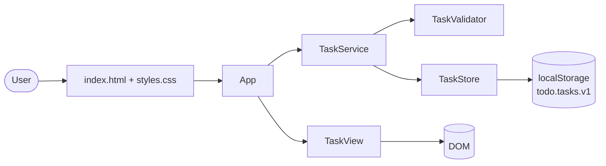
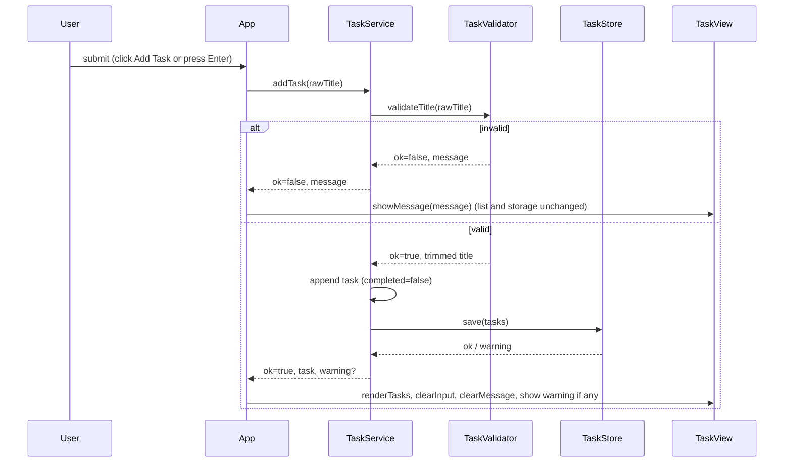

# Architecture — Create a TODO Task

Based on: docs/requirements.md v1   Version: 1   Status: Draft

## 1. Context & Goals

A static, single-page, single-user TODO page that runs from `index.html` with no server and no build step. The user enters a title, the page validates it, adds it to a list, and saves the list in browser local storage. Main drivers: FR-4/FR-11 (validation), FR-8/FR-9/FR-15 (persistence and its failure modes), NFR-6 (no markup injection), NFR-8 (logic testable without a browser), NFR-10 (no runtime dependencies, no build step).

## 2. Technology Choices

| Concern | Options considered | Decision | Rationale |
|---------|-------------------|----------|-----------|
| Language and UI | Vanilla HTML/CSS/JS; React + Vite; TypeScript + Vite | Vanilla HTML/CSS/JS | Human decision; satisfies NFR-10; the UI is one form and one list. |
| Code loading | A: classic `<script>` files with a small UMD-style wrapper; B: ES modules; C: one large script | A | ES modules do not load from `file://` in several browsers, which would break "open index.html" (NFR-10). A keeps separate files (NFR-8) and also works with `require` in Node tests. B needs a local web server. C mixes DOM and logic and is harder to test. |
| Persistence | `localStorage`; IndexedDB; cookies | `localStorage`, one key `todo.tasks.v1` holding a JSON array | Required by FR-8 and NFR-4. Data is tiny and synchronous access keeps the code simple. The key suffix allows a future format change. |
| Unit tests | Node built-in `node:test`; Jest; Vitest | `node:test` | Zero extra dependencies (NFR-8, NFR-10). |
| DOM and integration tests | jsdom (dev dependency); Playwright; hand-written DOM fake | jsdom, pinned in `devDependencies` | Runs `index.html` and the real scripts in Node without a browser, enough to cover scenarios S1-S5. Playwright adds browser downloads and CI weight for a page this small. It is a dev dependency, so NFR-10 (no runtime dependencies) still holds. |
| Task identity | Random UUID; timestamp; incrementing integer | Incrementing integer (highest existing id + 1) | Deterministic and testable. `crypto.randomUUID` is unavailable in some insecure contexts. |
| Title length rule | UTF-16 length; Unicode code point count | Code point count (`Array.from(title).length`) | A user counts characters, not UTF-16 units; emoji must not count double. |
| Length enforcement in the UI | HTML `maxlength` attribute; validation in code | Validation in code only | `maxlength` would stop the user typing the 101st character, so FR-11's validation message could never appear. |

## 3. Component Diagram



Dependency rule: `TaskValidator`, `TaskStore`, and `TaskService` never touch the DOM. Only `TaskView` and `App` use `document`.

## 4. Components & Responsibilities

| Component | Responsibility | Inputs | Outputs | Covers |
|-----------|----------------|--------|---------|--------|
| index.html + styles.css | Page structure: a `<form>` with a labelled input and an **Add Task** submit button, a message area (`role="status"`, `aria-live`), and a `<ul>` for tasks. Responsive layout. | none | static page | FR-1, FR-2, NFR-1, NFR-3, NFR-7 |
| TaskValidator | Pure function `validateTitle(rawTitle)`: trims; rejects empty or whitespace-only; rejects more than 100 code points; returns `{ ok: true, title }` or `{ ok: false, message }`. | raw string | result object | FR-4, FR-11, FR-13 |
| TaskStore | Reads and writes the list through an injected `Storage` object. `load()` returns `{ tasks, warning }`: warning is set if storage is unavailable, JSON is invalid, or any record is not a valid task (id integer, title non-empty string, completed boolean). `save(tasks)` returns `{ ok, warning }` and never throws. | `Storage`, task list | `{ tasks, warning }`, `{ ok, warning }` | FR-8, FR-9, FR-15, NFR-4, NFR-5 |
| TaskService | Holds the in-memory task list. `init()` loads from `TaskStore`. `addTask(rawTitle)` validates, creates `{ id, title, completed: false }`, appends to the end, saves, and returns `{ ok, task, message, warning }`. On rejection it changes nothing. If saving fails, the task stays in memory and a warning is returned. | `TaskValidator`, `TaskStore` | task list, result objects | FR-3, FR-4, FR-6, FR-8, FR-11, FR-13, FR-14, FR-15, FR-16 |
| TaskView | Renders the list and messages. Uses `textContent` and `createElement` only, never `innerHTML`. Shows each task title and an "incomplete" status. Sets and clears the message area. Clears and refocuses the input. | task list, messages | DOM updates | FR-5, FR-6, FR-7, FR-12, NFR-6, NFR-7 |
| App | Entry point. Creates the store (with `window.localStorage` guarded by try/catch), service, and view. Listens to the form `submit` event (covers both button click and Enter) and the input `input` event (clears the message). Calls `service.addTask`, then passes the result to the view. | DOM events | calls to service and view | FR-3, FR-5, FR-7, FR-10, FR-12 |

## 5. Data Flow



Page load: `App` calls `service.init()`, which calls `store.load()`. Valid data is rendered. Any failure yields an empty in-memory list and a warning shown by the view.

Failure flows:
- Empty, whitespace-only, or over-long title: rejected before any state change (FR-4, FR-11, FR-16).
- Local storage unavailable (access throws, as in some private modes): `TaskStore` reports a warning, and the app works in memory (FR-15).
- Stored JSON invalid or records malformed: whole list treated as unreadable, a warning is shown, and the stored value is left untouched until the next successful add overwrites it (FR-15).
- Save fails (quota or security error): the task stays in the list, and a warning says it may not persist after refresh.

## 6. Data Model / File Formats

Task: `{ "id": 1, "title": "Complete Java revision", "completed": false }`

Storage: `localStorage["todo.tasks.v1"]` = JSON array of tasks in creation order. An empty or missing key means no tasks, with no warning.

## 7. Error Handling Strategy

- All `localStorage` access happens in `TaskStore` inside try/catch; no exception reaches `TaskService`, `TaskView`, or `App`.
- Validation errors are normal results, not exceptions.
- User-facing messages are fixed strings; they never include stored data or exception text.
- A warning is non-blocking: the form stays usable.

## 8. Security Considerations

- All user text is inserted with `textContent`; `innerHTML`, `outerHTML`, `insertAdjacentHTML`, and `document.write` are not used (NFR-6). A test asserts this with an HTML payload title.
- Stored data is validated before use, so tampered storage cannot inject markup or non-string titles.
- No secrets, no network calls (NFR-4). A `<meta>` Content-Security-Policy (`default-src 'none'; script-src 'self'; style-src 'self'`) limits the page to its own files.
- No runtime dependencies; dev dependencies (jsdom) are pinned and audited with `npm audit`.

## 9. Testing Strategy

| Level | Tool | What it covers |
|-------|------|----------------|
| Unit | `node:test` with a fake `Storage` | TaskValidator (empty, whitespace, tabs, 100 vs 101 characters, emoji, trimming); TaskStore (valid load, missing key, invalid JSON, wrong shape, storage throws, save quota failure); TaskService (order, duplicates, ids, rejection leaves state unchanged, memory fallback) |
| Integration | `node:test` + jsdom loading the real `index.html` and scripts | Scenarios S1-S5 end to end: add via click and Enter, empty and whitespace messages, input cleared, message cleared on typing, refresh simulated by building a new app instance on the same storage, HTML-payload title shown literally |
| Static checks | grep in a test | No `innerHTML` or similar sinks in `src/` |
| Manual | browser | Responsive layout at 320 px and 1920 px, keyboard-only use, contrast (NFR-3, NFR-7, NFR-9) |

## 10. Project Structure

```
index.html
src/
  styles.css
  task-validator.js
  task-store.js
  task-service.js
  task-view.js
  app.js
tests/
  unit/            task-validator.test.js, task-store.test.js, task-service.test.js
  integration/     app.test.js
  fixtures/        stored-data samples (valid, corrupt, wrong shape)
package.json       scripts: "test"; devDependencies: jsdom (pinned); no dependencies
```

Module pattern: each file is an immediately-invoked function that attaches its API to `window.Todo` in the browser and to `module.exports` under Node. Dependencies are resolved with `require` in Node and `window.Todo.*` in the browser. Script tags in `index.html` load files in dependency order, with `app.js` last.

## 11. Risks & Open Questions

| # | Risk | Mitigation |
|---|------|------------|
| 1 | The dual browser/Node module wrapper is unusual and easy to get wrong. | Keep it identical in each file; cover it with the jsdom integration test that loads the real script tags. |
| 2 | jsdom is not a real browser, so layout and some Storage behaviour differ. | Manual check list for responsive layout; unit tests use a fake Storage for failure modes. |
| 3 | Overwriting unreadable stored data on the next add loses it permanently. | Accepted by FR-15; the warning tells the user. Open to review. |
| 4 | `file://` pages can have per-browser local storage quirks (Safari, Firefox privacy settings). | Covered by the storage-unavailable path (FR-15). |

## 12. Requirement Coverage

| Requirement | Component(s) |
|-------------|--------------|
| FR-1 | index.html |
| FR-2 | index.html |
| FR-3 | App, TaskService, TaskValidator |
| FR-4 | TaskValidator, TaskService, TaskView |
| FR-5 | TaskView, App |
| FR-6 | TaskService, TaskView |
| FR-7 | TaskView, App |
| FR-8 | TaskStore, TaskService |
| FR-9 | TaskStore, TaskService, App |
| FR-10 | index.html (form), App |
| FR-11 | TaskValidator, TaskView |
| FR-12 | App, TaskView |
| FR-13 | TaskValidator, TaskService |
| FR-14 | TaskService |
| FR-15 | TaskStore, TaskService, TaskView |
| FR-16 | TaskService |
| NFR-1 | index.html, styles.css |
| NFR-2 | App, TaskView (synchronous render in the submit handler) |
| NFR-3 | styles.css |
| NFR-4 | TaskStore (no network code anywhere; CSP) |
| NFR-5 | TaskStore, TaskService |
| NFR-6 | TaskView, TaskStore (validation on load) |
| NFR-7 | index.html, TaskView, styles.css |
| NFR-8 | TaskValidator, TaskStore, TaskService (DOM-free); test setup |
| NFR-9 | Plain ES2015+ syntax, no experimental APIs |
| NFR-10 | Module pattern, project structure, package.json |

## 13. Revision History

| Version | Date | Change | Trigger |
|---------|------|--------|---------|
| 1 | 2026-11-07 | Initial architecture | Approved requirements v1 |
