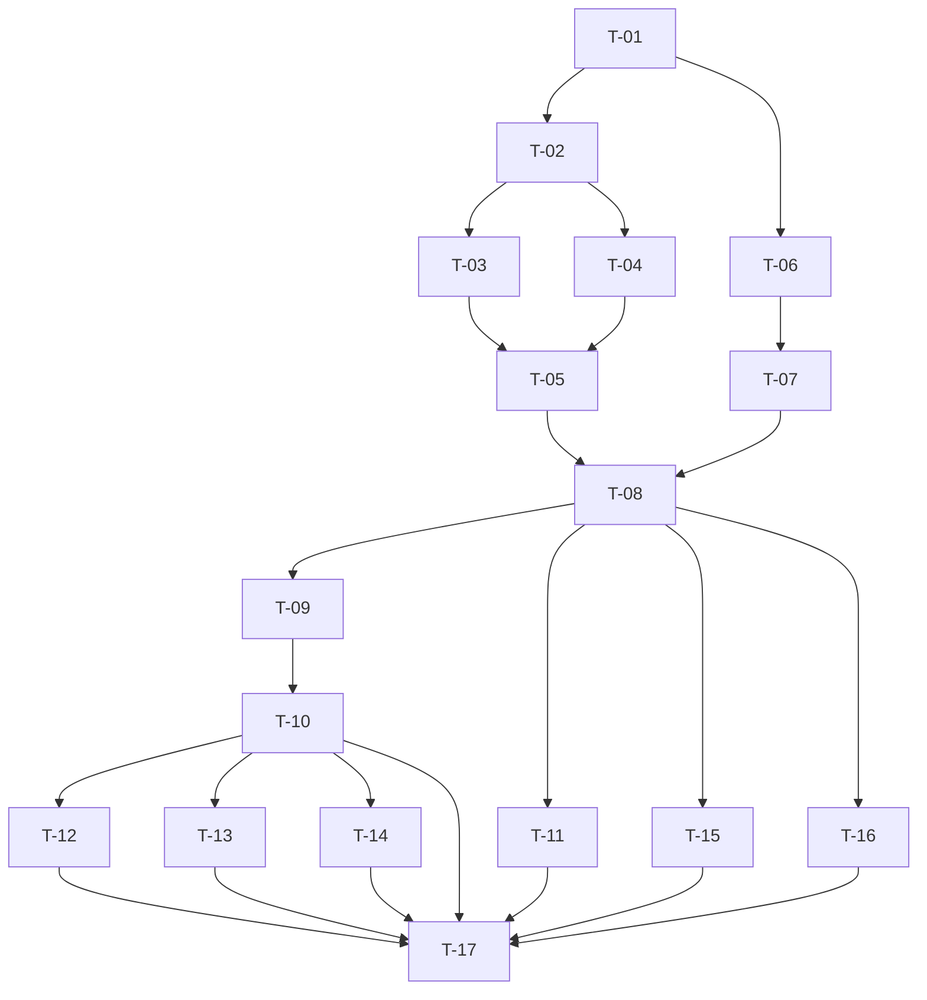

# Implementation Plan — Create a TODO Task

Based on: architecture.md v3, requirements.md v2, design-review.md (rounds 1-2, decisions DD-1 to DD-7)   Status: Draft

## 1. Task List

Execution order is the table order. Status values: Todo, In progress, Done, Blocked. "Blocked?" is the state at plan time; a task is blocked until every task in "Depends on" is Done.

| ID | Group | Title | Description / done-when | Covers | Component | Depends on | Status | Blocked? |
|----|-------|-------|--------------------------|--------|-----------|------------|--------|----------|
| T-01 | P0 | Project scaffold | `package.json` with `"type": "commonjs"`, `"engines": {"node": ">=20"}`, script `"test": "node --test"`, jsdom pinned in `devDependencies`, no `dependencies`; `npm install` succeeds; `npm test` runs (no tests yet) and exits 0; `.gitignore` keeps `node_modules/`. | NFR-8, NFR-10 | project | none | Done | No |
| T-02 | P0 | Test helpers | `tests/helpers/fake-storage.js` (Storage-like object with switchable failures: `getItem` throws, `setItem` throws, throws only for one key, quota failure) and `tests/helpers/load-modules.js` (runs `src/*.js` with `vm.runInThisContext` in order validator, store, service, view, app, resets `globalThis.Todo`, returns it). A helper self-test passes. | NFR-8 | test helpers | T-01 | Done | No |
| T-03 | P1 | TaskValidator + unit tests | `src/task-validator.js` in the file pattern of architecture section 10. Returns `{ ok, title }` or `{ ok:false, code:'EMPTY'\|'TOO_LONG' }`. Tests: every accept and reject case listed in architecture section 9 (Persian ZWNJ, Devanagari ZWJ, family emoji, subdivision flag, single emoji, ZWSP plus letter accepted; empty, spaces, tabs, NBSP, only ZWJ, only ZWNJ, only U+200B, U+2800, U+3164, mixed rejected), 100 accepted and 101 rejected, family emoji counts as several, trimming (`"  Buy milk  "` becomes `"Buy milk"`). | FR-4, FR-11, FR-13, NFR-8 | TaskValidator | T-02 | Done | No |
| T-04 | P1 | TaskStore + unit tests + fixtures | `src/task-store.js` with `read()`, `write()`, `backup()`, key `todo-app.tasks.v1`, backup key `todo-app.tasks.v1.unreadable`, all storage access inside try/catch. Fixtures under `tests/fixtures/`: valid, invalid JSON, not an array, missing field, float / negative / zero / duplicate / unsafe ids. Tests: statuses `ok`, `missing`, `unreadable`, `unavailable` (getter throws); write quota failure returns `{ ok:false }`; backup success; backup that throws on the backup key only; no exception ever escapes. | FR-8, FR-9, FR-15, NFR-4, NFR-5, NFR-6, NFR-8 | TaskStore | T-02 | Done | No |
| T-05 | P1 | TaskService + unit tests | `src/task-service.js` with `init()`, `addTask()`, `refresh()`, `pending` list, read-modify-write, id = max + 1 by loop, warning lifecycle. Tests: order and duplicates; ids unique; rejection leaves list and storage unchanged; unreadable data backed up then replaced, `UNREADABLE` then `null`; backup failure gives `BACKUP_FAILED` and the task is still added; `unavailable` keeps `UNAVAILABLE` and never `SAVE_FAILED`; `setItem` throws while `getItem` works: two adds leave two tasks, `refresh()` after a foreign write keeps the foreign and pending tasks, ids unique; two service instances on one fake storage lose no tasks. | FR-3, FR-6, FR-8, FR-14, FR-15, FR-16, FR-17, NFR-5, NFR-8 | TaskService | T-03, T-04 | Done | No |
| T-06 | P1 | Page markup and styles | `index.html` with the form (labelled input, **Add Task** submit button), messages block (alert region `#title-error`, visible warning status region, visually hidden confirmation status region), task `<ul>`, script tags in order at the end of `<body>`, inline bootstrap calling `Todo.startApp`. No inline handlers or styles, no CSP. `src/styles.css` responsive from 320 px to 1920 px, 44 px minimum button height and width, contrast at least 4.5:1, visually-hidden class using clip. | FR-1, FR-2, FR-10, NFR-1, NFR-3, NFR-7 | index.html, styles.css | T-01 | Done | No |
| T-07 | P1 | TaskView | `src/task-view.js`: `renderTasks`, `showError`, `clearError`, `showWarning`, `clearWarning`, `announceAdded`, `clearInput`, `focusInput`; all text through `createElement` and `textContent`; message strings keyed by code (including `BACKUP_FAILED`); `showError` sets `aria-invalid` and `aria-describedby="title-error"` and replaces children so repeats re-announce; each task shows its title and "incomplete". | FR-4, FR-5, FR-6, FR-7, FR-11, FR-12, FR-15, NFR-2, NFR-6, NFR-7 | TaskView | T-06 | Done | No |
| T-08 | P1 | App wiring (`Todo.startApp`) | `src/app.js`: wires factories, `init`, render, warning; listeners for form `submit` (`preventDefault()` first), input `input` (clears the error only), `window` `storage` (key matches or null: `refresh` and render); rejected submit keeps the value and focuses the input; success clears the input, clears the error, focuses the input, announces, applies the result warning. Opening `index.html` by hand adds a task that survives a refresh. | FR-3, FR-5, FR-7, FR-9, FR-10, FR-12, FR-17 | App | T-05, T-07 | Done | No |
| T-09 | P1 | jsdom page harness + smoke test | `tests/helpers/make-page.js` exactly as architecture section 9: reads `index.html`, `requestInterceptor` mapping `http://localhost/<path>` to repository files, `beforeParse` defining `window.localStorage` from a shared fake, `virtualConsole` failing the test on `jsdomError`, await `load`. Smoke test: the real page loads with zero `jsdomError`. | NFR-8 | test helpers | T-08 | Done | No |
| T-10 | P1 | Integration tests S1-S5 | `tests/integration/app.test.js`: S1 add by click, task listed as incomplete; S2 empty and S3 whitespace-only show the message, list and storage unchanged; S4 input cleared; S5 a second page on the same fake storage shows the task; add by `requestSubmit`; rejection keeps value and focuses the input; `aria-invalid` set then removed; typing clears the error while a load warning stays; HTML payload title shown literally (`li.textContent` equals payload, `querySelector('img')` is null); trimming; 101 code points shows the limit message. | FR-1 to FR-7, FR-9, FR-10, FR-12, FR-13, FR-14, FR-16, NFR-6 | App, TaskView | T-09 | Done | No |
| T-11 | P2 | Static checks test | `tests/integration/static-checks.test.js`: no `innerHTML`, `outerHTML`, `insertAdjacentHTML`, `document.write` in `src/`; no `fetch`, `XMLHttpRequest`, `WebSocket`, `sendBeacon`, `EventSource`; no `module` or `require` in `src/`; `package.json` has no `dependencies`. | NFR-4, NFR-6, NFR-10 | all | T-08 | Todo | Yes |
| T-12 | P2 | Large-list test | 500-task fixture rendered by the page; the list has 500 items and a coarse time bound is recorded in the test output (not asserted tightly). | NFR-2 | TaskView | T-10 | Todo | Yes |
| T-13 | P2 | Cross-tab tests | Integration tests: a change to the shared fake plus a synthetic `window.StorageEvent` with the matching key refreshes the list; `key: null` also refreshes; an unrelated key is ignored; a task added by a second page instance is kept when the first page adds. | FR-17, NFR-5 | App, TaskService | T-10 | Todo | Yes |
| T-14 | P2 | Accessibility tests | Integration tests: `aria-describedby` resolves to an element in the document; two identical adds each leave a new child in the confirmation region; the confirmation region is not `hidden` and not `display: none` in the stylesheet; load warning has `role="status"`, error region has `role="alert"`. | NFR-7 | TaskView, index.html | T-10 | Todo | Yes |
| T-15 | P3 | Manual test checklist | `docs/manual-test-checklist.md` with columns browser, version, opened from `file://`, and rows: add task, Enter key, refresh persists, two tabs, 320 px and 1920 px layout, 44 px button, keyboard-only use, screen reader (error and "Task added"), contrast, 500-task timing, move the folder, storage unavailable (private mode). Human fills it in; unfilled cells are `Not Found`. | NFR-2, NFR-3, NFR-7, NFR-9 | docs | T-08 | Todo | Yes |
| T-16 | P3 | README and CHANGELOG | `README.md` (purpose, how to open `index.html`, `npm install` and `npm test`, configuration: none, project structure, storage key and the note that tasks belong to the browser and file location, link to `docs/`); `CHANGELOG.md` `[Unreleased]` with Added entries; `.env.example` is not needed (no environment variables: record this in README). | NFR-10 | docs | T-08 | Todo | Yes |
| T-17 | P3 | Final verification run | `npm test` passes in full; `npm audit` output recorded; docs-sync `final-scope` reports in sync; traceability rebuilt with code and test columns. | NFR-8, NFR-10 | all | T-10 to T-16 | Todo | Yes |

## 2. Dependency Graph

## 3. Blocked Tasks

| Task | Blocked until | Reason |
|------|---------------|--------|
| T-02, T-06 | T-01 | Need `package.json` and the folder structure. |
| T-03, T-04 | T-02 | Tests need the fake storage and module loader. |
| T-05 | T-03, T-04 | Service uses the validator and the store. |
| T-07 | T-06 | View needs the element ids and regions in `index.html`. |
| T-08 | T-05, T-07 | Wires service and view. |
| T-09 | T-08 | Harness loads the real page and scripts. |
| T-10, T-12, T-13, T-14 | T-09 (T-10 directly; the rest via T-10) | Need the page harness. |
| T-11, T-15, T-16 | T-08 | Need the finished source. |
| T-17 | T-10 to T-16 | Final gate over everything. |

Parallel groups once unblocked: T-03 with T-04; T-06 with T-02; T-12, T-13, T-14 together; T-11, T-15, T-16 together.

## 4. Critical Path

T-01, T-02, T-04, T-05, T-08, T-09, T-10, T-17.

## 5. Test Strategy per Task Group

- P0: helper self-test; `npm test` exits 0.
- P1: unit tests accompany each logic task (T-03, T-04, T-05); the page is checked by the jsdom suite (T-09, T-10). Tests are written before or with the code.
- P2: cross-cutting tests (static, scale, cross-tab, accessibility) added after the integration base exists.
- P3: manual checklist (human), README accuracy checked by docs-sync, final full run and `npm audit`.
- Implementation approval gate G5 is presented after each priority group (P0, P1, P2, P3) with the test output.

## 6. Risks to Delivery

| # | Risk | Mitigation |
|---|------|------------|
| 1 | jsdom `ResourceLoader` or `localStorage` injection behaves differently from the plan. | T-09 is isolated and early; the smoke test shows failures at once. Fallback: set `window.localStorage` through `beforeParse` only and inline the scripts. |
| 2 | `npm install` or `npm audit` is blocked by the network or registry. | Report `Not Found: npm registry`; verification is then marked FAIL, not silently passed. |
| 3 | Manual checks (T-15) need the human and real browsers. | They are listed as limitations in the PR if not run; automated coverage is separate. |
| 4 | Real Enter-key and layout behaviour are not covered by jsdom. | Manual checklist; stated in PR Known Limitations. |

## 7. Requirement → Task Coverage

| Requirement | Tasks |
|-------------|-------|
| FR-1 | T-06, T-10 |
| FR-2 | T-06, T-10 |
| FR-3 | T-05, T-08, T-10 |
| FR-4 | T-03, T-05, T-07, T-10 |
| FR-5 | T-07, T-08, T-10 |
| FR-6 | T-05, T-07, T-10 |
| FR-7 | T-07, T-08, T-10 |
| FR-8 | T-04, T-05 |
| FR-9 | T-04, T-08, T-10 |
| FR-10 | T-06, T-08, T-10 |
| FR-11 | T-03, T-07, T-10 |
| FR-12 | T-07, T-08, T-10 |
| FR-13 | T-03, T-05, T-10 |
| FR-14 | T-05, T-10 |
| FR-15 | T-04, T-05, T-07 |
| FR-16 | T-05, T-10 |
| FR-17 | T-05, T-08, T-13 |
| NFR-1 | T-06 |
| NFR-2 | T-07, T-12, T-15 |
| NFR-3 | T-06, T-15 |
| NFR-4 | T-04, T-11 |
| NFR-5 | T-04, T-05, T-13 |
| NFR-6 | T-04, T-07, T-10, T-11 |
| NFR-7 | T-06, T-07, T-14, T-15 |
| NFR-8 | T-01, T-02, T-03, T-04, T-05, T-09, T-17 |
| NFR-9 | T-15 |
| NFR-10 | T-01, T-11, T-16, T-17 |
