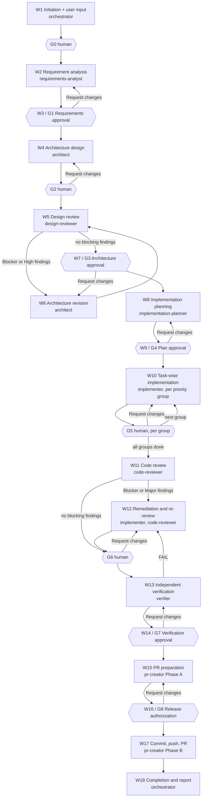
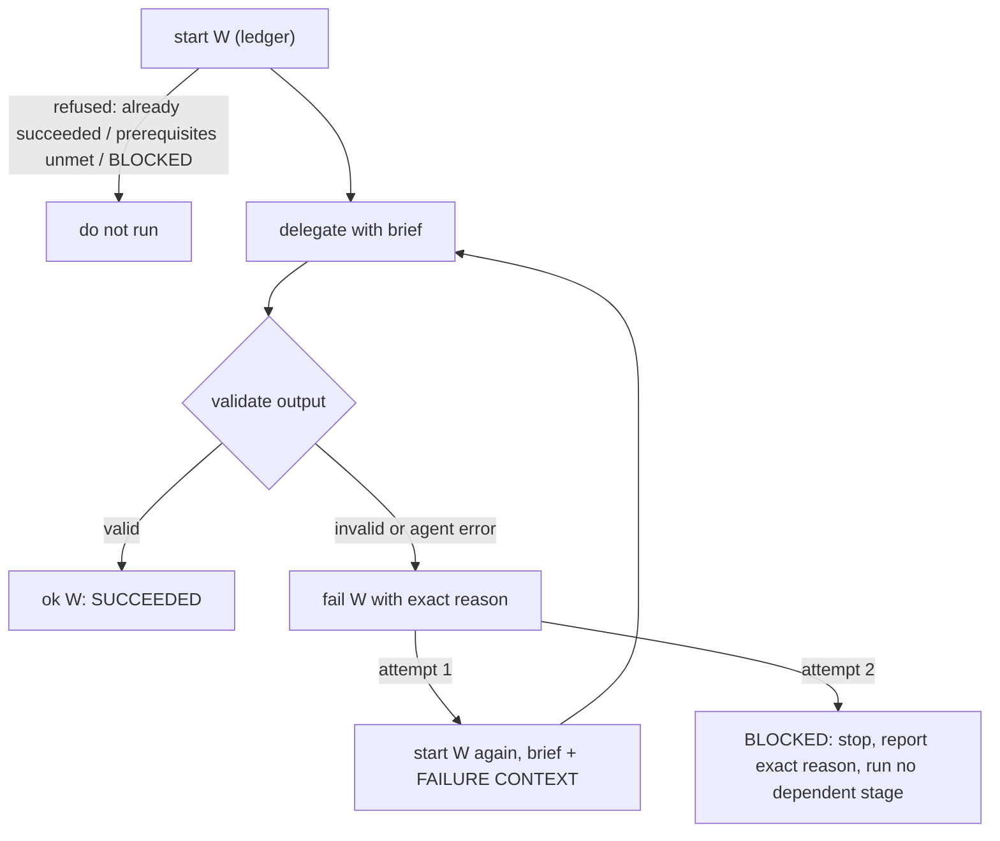

# SDLC Orchestrator — Workflow Stages, Retry and Approval Reference

Based on: `.claude/agents/sdlc-orchestrator.agent.md` (authoritative)   Version: 1   Status: Draft

This document explains the 18 workflow stages (W1-W18), who runs each one, what goes in and out, how each is validated, and what happens on failure. If it ever disagrees with the orchestrator agent file, the agent file wins and this file must be fixed (`npm run test:sdlc` checks that every stage and agent appears in both).

## 1. Three levels: orchestrator, agent, skill

| Level | Files | Controls | Does not do |
|-------|-------|----------|-------------|
| **Orchestrator** | `.claude/agents/sdlc-orchestrator.agent.md` | Stage order, delegation, validation, transitions, retries, human gates, `.sdlc/state.md`, retry ledger, git commits after approval | Write requirements, designs or code |
| **Agent** | `.claude/agents/<name>.agent.md` (9 specialists) | One stage's work; owns specific artifacts; returns a structured report | Decide the next stage, retry itself, talk to the human, edit artifacts it does not own |
| **Skill / instruction** | `.claude/skills/*/SKILL.md`, `.claude/instructions/*.instructions.md` | Reusable engineering knowledge: checklists, conventions, standards | Execute anything; they are read by agents |

Agents and the skills they apply:

| Agent | Skills | Instructions |
|-------|--------|--------------|
| `requirements-analyst` | `requirements-engineering`, `user-story-intake` (orchestrator-side) | documentation, security |
| `architect` | `architecture-design` | documentation, security |
| `design-reviewer` | `architecture-design` | documentation, security |
| `implementation-planner` | `architecture-design`, `testing-practices` | documentation |
| `implementer` | `js-implementation`, `testing-practices` | code, testing, security |
| `code-reviewer` | `code-review-checklist` (+ `js-implementation`, `testing-practices` as reference) | security |
| `verifier` | `verification-practices`, `testing-practices`, `docs-sync-check` | testing, security |
| `docs-sync` | `docs-sync-check` | documentation |
| `pr-creator` | `pr-authoring` | documentation, security |

All agents are bound by `agent-collaboration.instructions.md` and `security.instructions.md`.

## 2. Stage sequence

Rectangles are agent-executed stages (each with the retry loop in section 4). Hexagons are human decisions (revision cycle in section 5). `docs-sync` runs inside stages as part of validation. Original stage numbers (0-8) and gates (G0-G8) are unchanged:

| Original stage | W stages | Gate |
|----------------|----------|------|
| 0 Preflight | W1 | G0 |
| 1 Requirements | W2, W3 | G1 |
| 2 Architecture | W4 | G2 |
| 3 Design review | W5, W6, W7 | G3 |
| 4 Planning | W8, W9 | G4 |
| 5 Implementation | W10 (per group) | G5 per group |
| 6 Code review | W11, W12 | G6 |
| 7 Verify | W13, W14 | G7 |
| 8 Pull request | W15, W16, W17 | G8 |
| Finish | W18 | - |

## 3. Stage specifications

Common to every agent-executed stage: failure handling is the retry protocol (section 4); the stage is only started when the ledger confirms its prerequisites are done and approved; `docs-sync` stage-scope must report no unresolved items where listed.

### W1 — Workflow initiation and user input
- **Purpose:** find the user story, create the feature branch and state file, agree the plan with the human.
- **Agent:** orchestrator (uses `user-story-intake` skill). **Human approval:** G0.
- **Inputs:** file in `user-story/`, or a JIRA/Confluence key (MCP tool), or pasted text.
- **Outputs:** `.sdlc/state.md`, branch `feature/<slug>`, `docs/`.
- **Preconditions:** git repository (else ask before `git init`); never on `main`/`master`.
- **Validation:** story text non-empty; branch created and not a protected branch; state file exists; no credentials in extracted text (strip and tell the human).
- **Next:** W2 after G0 approval.
- **Failure handling:** retry once (e.g., extraction tool failed, try the next method). Second failure: BLOCKED with reason (e.g., "no readable story found").

### W2 — Requirement analysis
- **Purpose:** produce testable FR/NFR with Given/When/Then criteria.
- **Agent:** `requirements-analyst` (skill `requirements-engineering`).
- **Inputs:** extracted story, prior human answers. **Outputs:** `docs/requirements.md`.
- **Preconditions:** W1 approved.
- **Validation:** template sections 1-9; every FR has priority and Given/When/Then with positive, negative and boundary coverage; every NFR has a measurable target; no contradictions or vague words; no pending `OPEN QUESTIONS`; docs-sync clean.
- **Next:** W3. **Failure handling:** retry with the failed checks listed. `OPEN QUESTIONS` is not a failure: clarification loop (max 3 rounds) inside the same attempt.

### W3 — Requirements approval (HITL, G1)
- **Purpose:** human confirms the requirements. **Agent:** human (orchestrator presents the gate).
- **Inputs:** `docs/requirements.md`. **Outputs:** decision; on approval a commit of the stage files and `Status: Approved`.
- **Preconditions:** W2 succeeded (the ledger refuses `await` otherwise).
- **Validation:** a clear Approve / Request changes / Abort answer.
- **Next:** W4 on Approve; W2 revision cycle on Request changes (then W3 is shown again).
- **Failure handling:** none technical. Request changes is a revision (section 5), never a failure.

### W4 — Architecture design
- **Purpose:** components, technology choices, data flow, error and security design.
- **Agent:** `architect` (skill `architecture-design`). **Human approval:** G2 (draft approved before review).
- **Inputs:** `docs/requirements.md`, existing code. **Outputs:** `docs/architecture.md`.
- **Preconditions:** W3 approved.
- **Validation:** sections 1-13; §12 maps every FR/NFR to a component; at least two options per significant choice; Mermaid fences balanced; `architecture-design` §8 checklist; docs-sync clean.
- **Next:** W5 after G2. **Failure handling:** retry once with failure context; second failure BLOCKED. G2 Request changes re-invokes the architect (revision).

### W5 — Design review
- **Purpose:** find design problems before code exists.
- **Agent:** `design-reviewer` (skill `architecture-design`). **Human approval:** none here (G3 follows W6/W7).
- **Inputs:** requirements, architecture. **Outputs:** `docs/design-review.md` (Round n).
- **Preconditions:** W4 approved at G2.
- **Validation:** findings table with severity, evidence, recommendation, status; verdict present; `architecture.md` untouched by the reviewer.
- **Next:** W6 if any Blocker or High finding, else W6 is skipped and W7 follows.
- **Failure handling:** retry once. Findings are valid output, not failures.

### W6 — Architecture revision
- **Purpose:** fix Blocker/High findings (or apply G3 human feedback).
- **Agent:** `architect`. **Inputs:** findings, architecture. **Outputs:** revised `docs/architecture.md` with revision-history rows.
- **Preconditions:** W5 reported blocking findings (otherwise `skip W6`). **Validation:** each finding ID fixed or explained; §12 still complete; docs-sync clean.
- **Next:** W5 re-review once (max two review rounds), then W7. **Failure handling:** retry once, then BLOCKED.

### W7 — Architecture approval (HITL, G3)
- **Inputs:** architecture, design review with verdict and remaining risks. **Preconditions:** W5 succeeded and W6 succeeded or skipped.
- **Next:** W8 on Approve; W6 revision cycle (then W5 re-review as the orchestrator decides) on Request changes. After two review rounds, remaining items are escalated here.
- **Failure handling:** none technical; revisions follow section 5.

### W8 — Implementation planning
- **Agent:** `implementation-planner`. **Inputs:** requirements, architecture, design review. **Outputs:** `docs/impl-plan.md`.
- **Preconditions:** W7 approved. **Validation:** every FR/NFR in §7 has a task; dependency graph acyclic; tasks small with done-when criteria and test criteria; groups ordered P0-P3; docs-sync clean.
- **Next:** W9. **Failure handling:** retry once with failure context, then BLOCKED.

### W9 — Plan approval (HITL, G4)
- **Inputs:** `docs/impl-plan.md`. **Next:** W10 on Approve; W8 revision cycle on Request changes. No technical failure handling.

### W10 — Task-wise implementation
- **Purpose:** implement tasks with tests, one priority group at a time.
- **Agent:** `implementer` (skills `js-implementation`, `testing-practices`). **Human approval:** G5 per group. Ledger ids `W10:P0`, `W10:P1`, ...
- **Inputs:** plan, architecture, requirements. **Outputs:** code, tests, tasks marked `Done`.
- **Preconditions:** W9 approved; each task's dependencies `Done`; blocked tasks are never started.
- **Validation:** per-task report; the orchestrator runs the project test command itself (exit 0); `git diff --stat` matches the report; no secrets; no unrelated refactoring; docs-sync clean.
- **Next:** G5, then the next group; after the last group W11.
- **Failure handling:** retry the group once, passing only tasks that failed or are not `Done` (finished tasks are not redone, no duplicate edits or commits). Second failure BLOCKED with the failing task ID.

### W11 — Code review
- **Agent:** `code-reviewer` (skill `code-review-checklist`). **Inputs:** requirements, architecture, plan, diff. **Outputs:** `docs/code-review.md`.
- **Preconditions:** all W10 groups approved.
- **Validation:** 15 checks with results; every finding has severity (Blocker/Major/Minor/Suggestion) and `path:line`; verdict; `git status` shows only `docs/code-review.md` changed by the reviewer.
- **Next:** W12 if Blocker/Major findings, else directly to G6 (W12 completes as "no remediation required").
- **Failure handling:** retry once. A reviewer that edited code fails validation; revert only its edits and retry with that stated.

### W12 — Code remediation and re-review
- **Agents:** `implementer` fixes, then `code-reviewer` re-reviews (each execution retry-protected). **Human approval:** G6.
- **Inputs:** findings. **Outputs:** fixes with regression tests, updated findings statuses.
- **Preconditions:** W11 succeeded. With no Blocker/Major findings W12 completes at once as "no remediation required" and G6 is still presented.
- **Validation:** each Blocker/Major is Fixed, Won't fix with reason, or escalated; tests pass (orchestrator re-runs); re-review done; max 2 remediation loops.
- **Next:** G6, then W13. **Failure handling:** retry per execution; after 2 loops open items are escalated to the human at G6. Only the implementer ever changes code.

### W13 — Independent verification and testing
- **Agent:** `verifier` (skills `verification-practices`, `testing-practices`, `docs-sync-check`).
- **Inputs:** requirements, code, tests. **Outputs:** `docs/verification-report.md` with Status PASS, FAIL or BLOCKED.
- **Preconditions:** W12 approved at G6.
- **Validation:** real commands and output; requirement-to-test table; the orchestrator re-runs the test command and the counts match; documentation consistent.
- **Next:** W14. A FAIL verdict is valid output: defects go to `implementer` and `verifier` re-runs (max 2 loops).
- **Failure handling:** a missing, unsupported or unreproducible report is a technical failure: retry once, then BLOCKED.

### W14 — Verification approval (HITL, G7)
- **Applicability:** always presented. A FAIL or BLOCKED report is shown as `FAILED`/`BLOCKED` and is never presentable as passing; the human decides (accept risk, request fixes, abort).
- **Next:** W15 on Approve; W13 revision cycle on Request changes.

### W15 — PR preparation
- **Agent:** `pr-creator` Phase A (skill `pr-authoring`). **Inputs:** all docs, git log/diff, verification report. **Outputs:** `docs/pr-description.md`, `CHANGELOG.md`.
- **Preconditions:** W14 approved. **No external side effects.**
- **Validation:** `node scripts/sdlc/check-pr-body.js docs/pr-description.md` exits 0 (AI disclosure verbatim under the title, five sections in order, reviewer checklist); Test Evidence is real output; final-scope docs-sync `in sync`.
- **Next:** W16. **Failure handling:** retry once, then BLOCKED.

### W16 — Human authorization for release (HITL, G8)
- **Presents:** PR title, body, exact `git push` and `gh pr create` commands. Approval is the only authority for W17. Silence is not approval. Next: W17 on Approve; W15 revision cycle on Request changes.

### W17 — Git commit, push and PR creation
- **Agent:** `pr-creator` Phase B. **Inputs:** approved branch, PR body. **Outputs:** pushed branch, PR URL, AI annotation.
- **Preconditions:** W16 approved; `gh` installed and authenticated; remote exists; not `main`/`master`.
- **Validation:** remote branch equals local `HEAD`; PR URL from `gh`; `gh pr view` shows the AI disclosure in the body; each side effect recorded once in the ledger.
- **Idempotency:** keys `push:<branch>`, `pr-create:<branch>`, `pr-comment:<branch>:ai-disclosure`. Before each action check the ledger and GitHub (`git ls-remote`, `gh pr list --head`, existing comments for the marker `<!-- ai-sdlc-disclosure -->`). A retry runs only the missing step. The PR comment is optional and best-effort (the PR body is the authoritative annotation).
- **Never:** merge, force-push, push to a protected branch, create a second PR.
- **Next:** W18. **Failure handling:** retry once; second failure BLOCKED with the failing step and reason; steps already done stay recorded.

### W18 — Final workflow completion and reporting
- **Purpose:** close the run with an evidence-based report.
- **Agent:** orchestrator. **Inputs:** `.sdlc/state.md`, retry ledger, all artifacts, W17 results. **Outputs:** final report, state `COMPLETE`.
- **Preconditions:** W17 succeeded, or W16 approved with the manual commands delivered because `gh` was unavailable.
- **Validation:** report lists which of {pushed, PR created, AI disclosure confirmed, comment posted} succeeded with evidence, the stage table, the retry summary and limitations; no claim without evidence.
- **Next:** none; the workflow ends and the PR stays open for human review and merge. The workflow never merges.
- **Failure handling:** retry once (e.g., a report file could not be written); second failure BLOCKED with the reason.

## 4. Retry protocol (every agent-executed stage)

Policy: maximum **2 attempts** per stage (initial + 1 retry). Retries are independent per stage: a stage that succeeded is never re-run, and a stage whose prerequisite failed never starts.

1. **Count:** `scripts/sdlc/retry-ledger.js` keeps the attempt counter per stage in `.sdlc/retry-ledger.json`.
2. **Capture:** `fail <W> "<reason>" "
"` stores the reason and details (secrets scrubbed) before anything is retried.
3. **Feed back:** the second brief includes `FAILURE CONTEXT` (stage, attempt number, reason, validation messages, trimmed error output, what was valid). The agent corrects only what failed.
4. **Revalidate:** the same validation criteria apply to the retried output.
5. **Give up:** a second failure sets status `BLOCKED` with the exact reason in `.sdlc/state.md`; the human decides what to fix; resuming uses `reopen`, a recorded human decision.
6. **Evidence:** `.sdlc/retry-ledger.json` (data) and `.sdlc/retry-log.md` (table: stage, attempt, outcome, reason, time) plus a summary in `.sdlc/state.md` under *Retry log*.

Counts as a failure: agent error/timeout/empty reply, missing or malformed output, failed validation, a required command exiting non-zero, an agent editing a file it does not own.
Does not count: `OPEN QUESTIONS`, human Request changes, reviewer findings, a verifier FAIL verdict, a human Abort.

**Side effects.** Commits after approval, `git push`, PR creation and the PR comment are guarded by ledger keys (`commit:G<n>`, `push:<branch>`, `pr-create:<branch>`, `pr-comment:<branch>:ai-disclosure`) and by a check of the real remote state, so a retry never duplicates a commit, PR or comment.

## 5. Human approval and revision cycles

| Situation | Handling | Counts toward retry limit? |
|-----------|----------|----------------------------|
| Approve | `approve` in ledger, commit stage files once, continue | no |
| Request changes | feedback captured verbatim; owning stage reopened with a fresh attempt budget; owner revises (`REVISION FEEDBACK`); revised artifact validated; **same gate presented again** | no |
| Abort | state `ABORTED`, stop | no |
| Agent fails while producing a revision | normal retry protocol for that execution | yes, for that execution only |

The gate cannot be skipped: the ledger refuses `approve` unless the gate was presented after the last successful run of its stage. After 3 revision cycles on one gate the orchestrator asks whether to continue; it never refuses a revision.

Bounded loops that are not retries: clarification (3 rounds), design review (2 rounds), code review/fix (2 loops), verification/fix (2 loops).

## 6. Limitations

- The agent platform has no declarative retry, backoff or loop property, and `agents:` lists only which subagents may be called. Retry is therefore enforced by the orchestrator's instructions and the ledger script, which the orchestrator calls with its `execute` tool. A model that ignores its instructions would bypass it; hooks cannot intercept subagent calls.
- The ledger script has been exercised by automated tests with simulated failures and a fake GitHub (`npm run test:sdlc`). It has not been run in a live orchestrated session with real subagent failures.
- No backoff delay is applied between attempts; they are immediate.
- Existing `.sdlc/state.md` describes the completed run before this change; the ledger starts with the next run.
